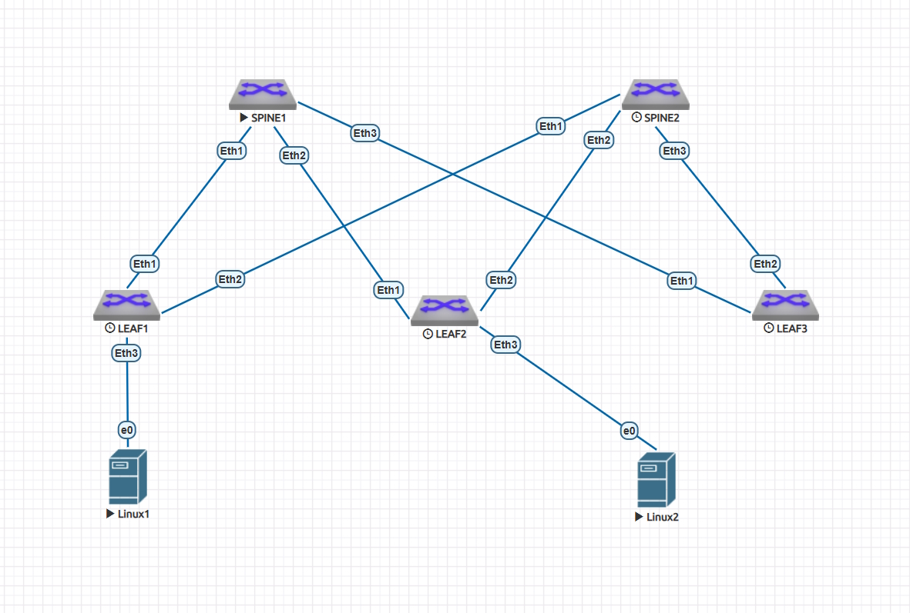
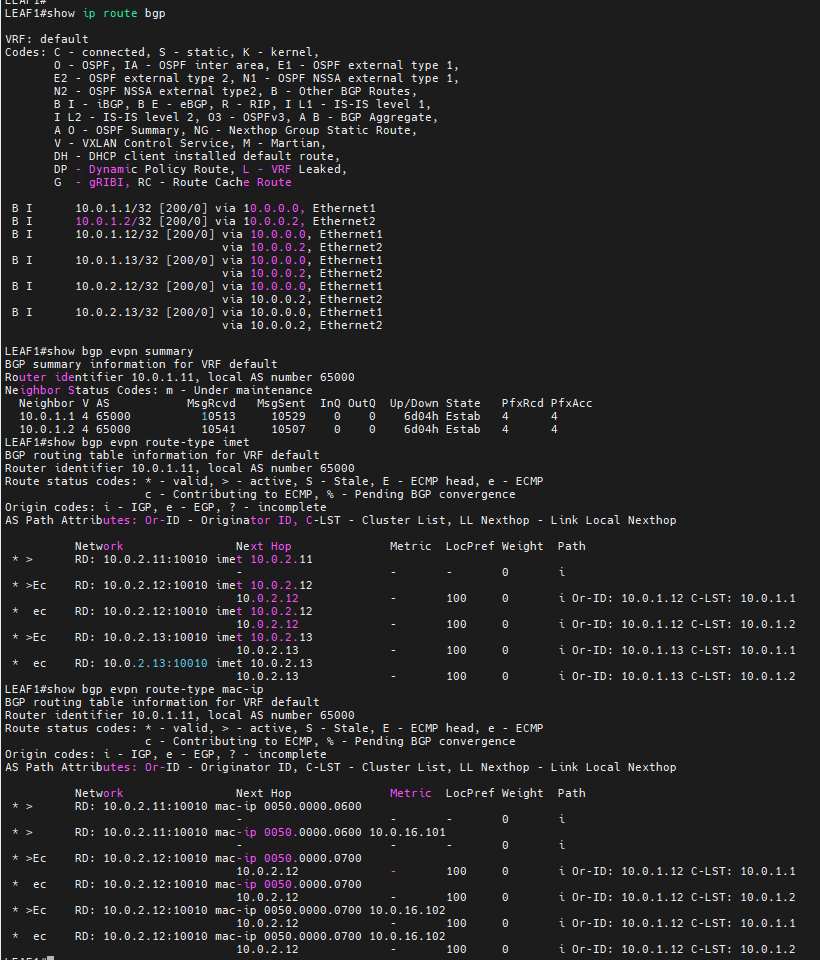
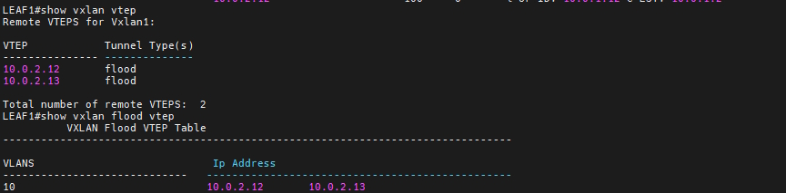
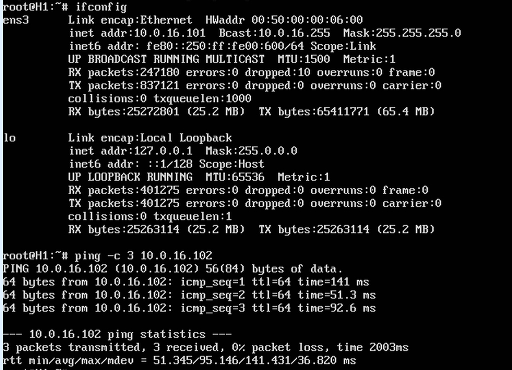
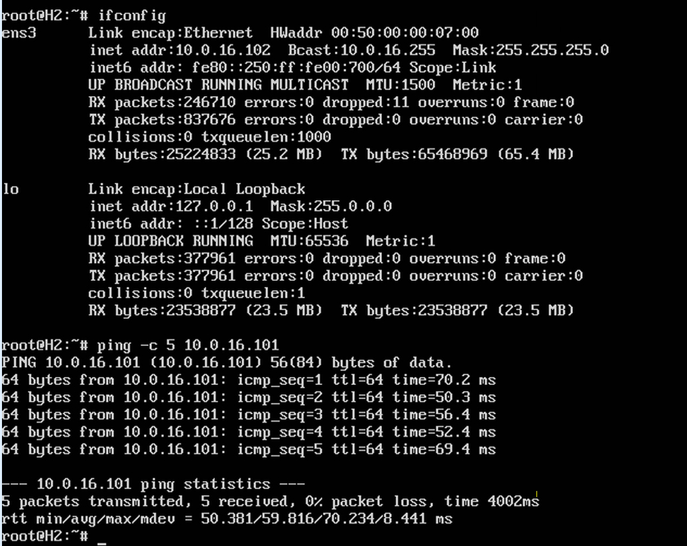
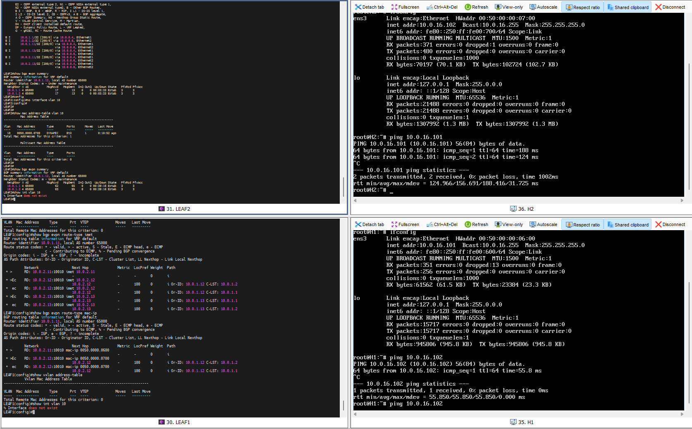
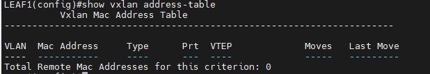

# Underlay. BGP + Overlay. EVPN/VXLAN

## Цель

Настроить BGP для Underlay сети и BGP EVPN для Overlay, обеспечить IP-связность между всеми сетевыми устройствами и L2-связность между клиентами первой зоны через VXLAN.

---

## Адресное пространство

Сеть DC `10.0.0.0/16`

| Назначение | CIDR | Использование |
|---|---|---|
| Loopback устройств | `10.0.1.0/24` | Router-ID, BGP |
| Underlay P2P | `10.0.0.0/24` | Spine ↔ Leaf |
| VTEP/Overlay Loopback | `10.0.2.0/24` | VXLAN VTEP |
| Service | `10.0.16.0/20` | Клиентские/серверные сети |

---

## Таблицы IP-адресов

### Loopback0 (Router-ID)

| Device | Interface | IP | Назначение |
|---|---|---|---|
| SPINE1 | Lo0 | `10.0.1.1/32` | Router-ID, BGP |
| SPINE2 | Lo0 | `10.0.1.2/32` | Router-ID, BGP |
| LEAF1 | Lo0 | `10.0.1.11/32` | Router-ID, BGP |
| LEAF2 | Lo0 | `10.0.1.12/32` | Router-ID, BGP |
| LEAF3 | Lo0 | `10.0.1.13/32` | Router-ID, BGP |

### Loopback1 (VTEP)

| Device | Interface | IP | Назначение |
|---|---|---|---|
| LEAF1 | Lo1 | `10.0.2.11/32` | VXLAN VTEP |
| LEAF2 | Lo1 | `10.0.2.12/32` | VXLAN VTEP |
| LEAF3 | Lo1 | `10.0.2.13/32` | VXLAN VTEP |

### Underlay P2P (Spine ↔ Leaf)

| Device | Interface | IP | Подключение |
|---|---|---|---|
| SPINE1 | Eth1 | `10.0.0.0/31` | LEAF1 |
| SPINE1 | Eth2 | `10.0.0.4/31` | LEAF2 |
| SPINE1 | Eth3 | `10.0.0.8/31` | LEAF3 |
| SPINE2 | Eth1 | `10.0.0.2/31` | LEAF1 |
| SPINE2 | Eth2 | `10.0.0.6/31` | LEAF2 |
| SPINE2 | Eth3 | `10.0.0.10/31` | LEAF3 |
| LEAF1 | Eth1 | `10.0.0.1/31` | SPINE1 |
| LEAF1 | Eth2 | `10.0.0.3/31` | SPINE2 |
| LEAF2 | Eth1 | `10.0.0.5/31` | SPINE1 |
| LEAF2 | Eth2 | `10.0.0.7/31` | SPINE2 |
| LEAF3 | Eth1 | `10.0.0.9/31` | SPINE1 |
| LEAF3 | Eth2 | `10.0.0.11/31` | SPINE2 |

### Service (VLAN 10, Zone 1)

| Хост | Leaf | Interface | IP | Шлюз |
|---|---|---|---|---|
| H1 | LEAF1 | Eth3 | `10.0.16.101/24` | `10.0.16.1` |
| H2 | LEAF2 | Eth3 | `10.0.16.102/24` | `10.0.16.1` |


### EVPN / VXLAN

| Параметр | Значение |
|---|---|
| AS | `65000` |
| VLAN | `10` (ZONE-1) |
| VNI | `10010` |
| Route Target | `65000:10010` |
| Route Distinguisher | `<VTEP-IP>:10010` |
| Anycast SVI | `10.0.16.1/24` |

---

## Схема сети



## План работы

### Часть 1. Underlay

1. Настраиваем IP-адресацию на физических интерфейсах (P2P `/31`).
2. Настраиваем Loopback0 (`10.0.1.0/24`) для Router-ID.
3. Настраиваем iBGP в AS 65000

### Часть 2. Overlay (EVPN/VXLAN)

4. Настраиваем Loopback1 (`10.0.2.0/24`) как VTEP на Leaf-ах.
5. Настраиваем iBGP-сессии по Loopback0 между Leaf и Spine с AF `L2VPN EVPN`.
6. Spine остаётся Route Reflector для EVPN
7. Настраиваем VxLAN
8. Подключаем клиентов к Eth3 и настраиваем IP.

---

## Конфигурация устройств

### SPINE1

```
hostname SPINE1
!
service routing protocols model multi-agent
!
interface Ethernet1
   description LEAF1
   no switchport
   ip address 10.0.0.0/31
!
interface Ethernet2
   description LEAF2
   no switchport
   ip address 10.0.0.4/31
!
interface Ethernet3
   description LEAF3
   no switchport
   ip address 10.0.0.8/31
!
interface Loopback0
   description Router-ID
   ip address 10.0.1.1/32
!
ip routing
!
route-map RM_connect permit 10
   match interface Loopback0
!
router bgp 65000
   router-id 10.0.1.1
   maximum-paths 10
   neighbor 10.0.0.1 remote-as 65000
   neighbor 10.0.0.1 next-hop-self
   neighbor 10.0.0.1 route-reflector-client
   neighbor 10.0.0.5 remote-as 65000
   neighbor 10.0.0.5 next-hop-self
   neighbor 10.0.0.5 route-reflector-client
   neighbor 10.0.0.9 remote-as 65000
   neighbor 10.0.0.9 next-hop-self
   neighbor 10.0.0.9 route-reflector-client
   neighbor 10.0.1.11 remote-as 65000
   neighbor 10.0.1.11 update-source Loopback0
   neighbor 10.0.1.11 route-reflector-client
   neighbor 10.0.1.12 remote-as 65000
   neighbor 10.0.1.12 update-source Loopback0
   neighbor 10.0.1.12 route-reflector-client
   neighbor 10.0.1.13 remote-as 65000
   neighbor 10.0.1.13 update-source Loopback0
   neighbor 10.0.1.13 route-reflector-client
   redistribute connected route-map RM_connect
   !
   address-family evpn
      neighbor 10.0.1.11 activate
      neighbor 10.0.1.12 activate
      neighbor 10.0.1.13 activate
   !
   address-family ipv4
      neighbor 10.0.0.1 activate
      neighbor 10.0.0.5 activate
      neighbor 10.0.0.9 activate
!
end
```

### SPINE2

```
hostname SPINE2
!
service routing protocols model multi-agent
!
interface Ethernet1
   description LEAF1
   no switchport
   ip address 10.0.0.2/31
!
interface Ethernet2
   description LEAF2
   no switchport
   ip address 10.0.0.6/31
!
interface Ethernet3
   description LEAF3
   no switchport
   ip address 10.0.0.10/31
!
interface Loopback0
   description Router-ID
   ip address 10.0.1.2/32
!
ip routing
!
route-map RM_connect permit 10
   match interface Loopback0
!
router bgp 65000
   router-id 10.0.1.2
   maximum-paths 10
   neighbor 10.0.0.3 remote-as 65000
   neighbor 10.0.0.3 next-hop-self
   neighbor 10.0.0.3 route-reflector-client
   neighbor 10.0.0.7 remote-as 65000
   neighbor 10.0.0.7 next-hop-self
   neighbor 10.0.0.7 route-reflector-client
   neighbor 10.0.0.11 remote-as 65000
   neighbor 10.0.0.11 next-hop-self
   neighbor 10.0.0.11 route-reflector-client
   neighbor 10.0.1.11 remote-as 65000
   neighbor 10.0.1.11 update-source Loopback0
   neighbor 10.0.1.11 route-reflector-client
   neighbor 10.0.1.12 remote-as 65000
   neighbor 10.0.1.12 update-source Loopback0
   neighbor 10.0.1.12 route-reflector-client
   neighbor 10.0.1.13 remote-as 65000
   neighbor 10.0.1.13 update-source Loopback0
   neighbor 10.0.1.13 route-reflector-client
   redistribute connected route-map RM_connect
   !
   address-family evpn
      neighbor 10.0.1.11 activate
      neighbor 10.0.1.12 activate
      neighbor 10.0.1.13 activate
   !
   address-family ipv4
      neighbor 10.0.0.3 activate
      neighbor 10.0.0.7 activate
      neighbor 10.0.0.11 activate
!
end
```

### LEAF1

```
hostname LEAF1
!
service routing protocols model multi-agent
!
vlan 10
   name ZONE-1
!
interface Ethernet1
   description SPINE1
   no switchport
   ip address 10.0.0.1/31
!
interface Ethernet2
   description SPINE2
   no switchport
   ip address 10.0.0.3/31
!
interface Ethernet3
   description CLIENT-ZONE1
   switchport access vlan 10
!
interface Loopback0
   description Router-ID
   ip address 10.0.1.11/32
!
interface Loopback1
   description VTEP
   ip address 10.0.2.11/32
!
interface Vlan10
   ip address virtual 10.0.16.1/24
!
interface Vxlan1
   vxlan source-interface Loopback1
   vxlan udp-port 4789
   vxlan vlan 10 vni 10010
   vxlan vlan 10 flood vtep 10.0.2.12 10.0.2.13
!
ip routing
!
route-map RM_connect permit 10
   match interface Loopback0
!
route-map RM_connect permit 20
   match interface Loopback1
!
router bgp 65000
   router-id 10.0.1.11
   maximum-paths 10
   neighbor 10.0.0.0 remote-as 65000
   neighbor 10.0.0.2 remote-as 65000
   neighbor 10.0.1.1 remote-as 65000
   neighbor 10.0.1.1 update-source Loopback0
   neighbor 10.0.1.2 remote-as 65000
   neighbor 10.0.1.2 update-source Loopback0
   redistribute connected route-map RM_connect
   !
   vlan 10
      rd 10.0.2.11:10010
      route-target both 65000:10010
      redistribute learned
   !
   address-family evpn
      neighbor 10.0.1.1 activate
      neighbor 10.0.1.2 activate
   !
   address-family ipv4
      neighbor 10.0.0.0 activate
      neighbor 10.0.0.2 activate
!
end
```

### LEAF2

```
hostname LEAF2
!
service routing protocols model multi-agent
!
vlan 10
   name ZONE-1
!
interface Ethernet1
   description SPINE1
   no switchport
   ip address 10.0.0.5/31
!
interface Ethernet2
   description SPINE2
   no switchport
   ip address 10.0.0.7/31
!
interface Ethernet3
   description CLIENT-ZONE1
   switchport access vlan 10
!
interface Loopback0
   description Router-ID
   ip address 10.0.1.12/32
!
interface Loopback1
   description VTEP
   ip address 10.0.2.12/32
!
interface Vlan10
   ip address virtual 10.0.16.1/24
!
interface Vxlan1
   vxlan source-interface Loopback1
   vxlan udp-port 4789
   vxlan vlan 10 vni 10010
   vxlan vlan 10 flood vtep 10.0.2.11 10.0.2.13
!
ip routing
!
route-map RM_connect permit 10
   match interface Loopback0
!
route-map RM_connect permit 20
   match interface Loopback1
!
router bgp 65000
   router-id 10.0.1.12
   maximum-paths 10
   neighbor 10.0.0.4 remote-as 65000
   neighbor 10.0.0.6 remote-as 65000
   neighbor 10.0.1.1 remote-as 65000
   neighbor 10.0.1.1 update-source Loopback0
   neighbor 10.0.1.2 remote-as 65000
   neighbor 10.0.1.2 update-source Loopback0
   redistribute connected route-map RM_connect
   !
   vlan 10
      rd 10.0.2.12:10010
      route-target both 65000:10010
      redistribute learned
   !
   address-family evpn
      neighbor 10.0.1.1 activate
      neighbor 10.0.1.2 activate
   !
   address-family ipv4
      neighbor 10.0.0.4 activate
      neighbor 10.0.0.6 activate
!
end
```

### LEAF3

```
hostname LEAF3
!
service routing protocols model multi-agent
!
vlan 10
   name ZONE-1
!
interface Ethernet1
   description SPINE1
   no switchport
   ip address 10.0.0.9/31
!
interface Ethernet2
   description SPINE2
   no switchport
   ip address 10.0.0.11/31
!
interface Ethernet3
   description CLIENT-ZONE1
   switchport access vlan 10
!
interface Loopback0
   description Router-ID
   ip address 10.0.1.13/32
!
interface Loopback1
   description VTEP
   ip address 10.0.2.13/32
!
interface Vlan10
   ip address virtual 10.0.16.1/24
!
interface Vxlan1
   vxlan source-interface Loopback1
   vxlan udp-port 4789
   vxlan vlan 10 vni 10010
   vxlan vlan 10 flood vtep 10.0.2.11 10.0.2.12
!
ip routing
!
route-map RM_connect permit 10
   match interface Loopback0
!
route-map RM_connect permit 20
   match interface Loopback1
!
router bgp 65000
   router-id 10.0.1.13
   maximum-paths 10
   neighbor 10.0.0.8 remote-as 65000
   neighbor 10.0.0.10 remote-as 65000
   neighbor 10.0.1.1 remote-as 65000
   neighbor 10.0.1.1 update-source Loopback0
   neighbor 10.0.1.2 remote-as 65000
   neighbor 10.0.1.2 update-source Loopback0
   redistribute connected route-map RM_connect
   !
   vlan 10
      rd 10.0.2.13:10010
      route-target both 65000:10010
      redistribute learned
   !
   address-family evpn
      neighbor 10.0.1.1 activate
      neighbor 10.0.1.2 activate
   !
   address-family ipv4
      neighbor 10.0.0.8 activate
      neighbor 10.0.0.10 activate
!
end
```

### Клиенты (Ubuntu 16.04 Server)

Файл `/etc/network/interfaces`:

**H1 (LEAF1):**

```
auto ens3
iface ens3 inet static
    address 10.0.16.101
    netmask 255.255.255.0
    gateway 10.0.16.1
```

**H2 (LEAF2):**

```
auto ens3
iface ens3 inet static
    address 10.0.16.102
    netmask 255.255.255.0
    gateway 10.0.16.1
```

---

## Соседство и маршруты

Для примера приведены выводы команд с LEAF1





### Связность клиентов







### Ответы по замечаниями






