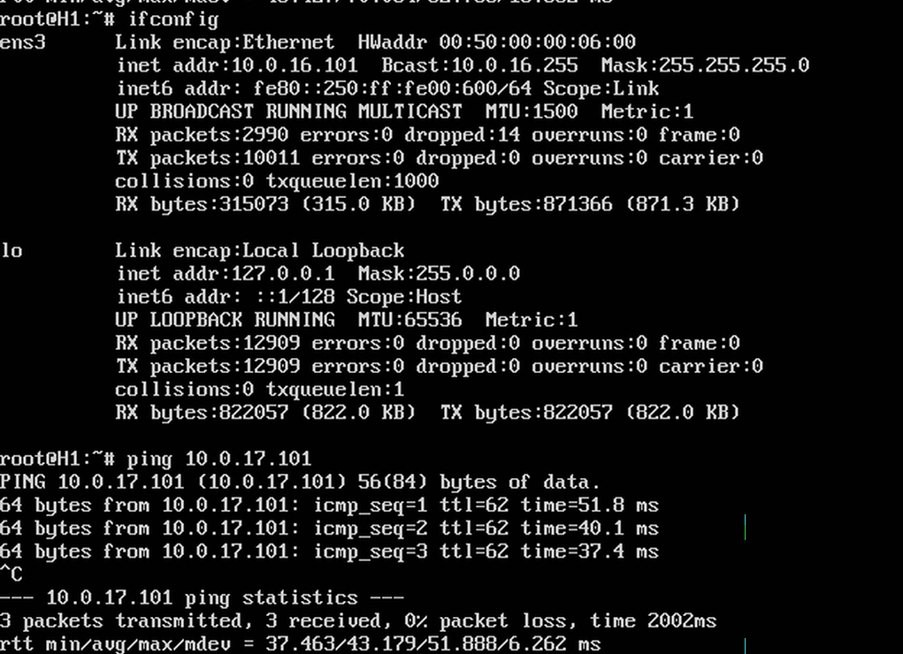
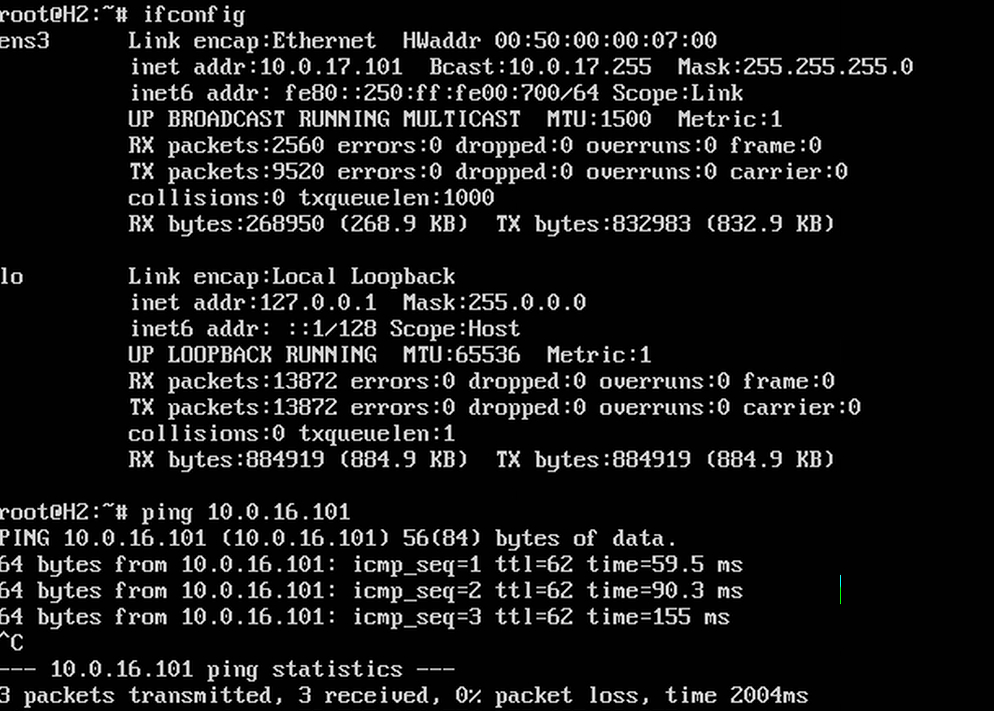

# VXLAN. L3VNI

## Цель

настроить маршрутизацию в рамках Overlay между клиентами.

В этой самостоятельной работе мы ожидаем, что вы самостоятельно:

Настроите каждого клиента в своем VNI
Настроите маршрутизацию между клиентами.
Зафиксируете в документации - план работы, адресное пространство, схему сети, конфигурацию устройств
---

## Адресное пространство

Сеть DC `10.0.0.0/16`

| Назначение | CIDR | Использование |
|---|---|---|
| Loopback устройств | `10.0.1.0/24` | Router-ID, BGP |
| Underlay P2P | `10.0.0.0/24` | Spine ↔ Leaf |
| VTEP/Overlay Loopback | `10.0.2.0/24` | VXLAN VTEP |
| Service | `10.0.16.0/20` | Клиентские/серверные сети |

---

## Таблицы IP-адресов

### Loopback0 (Router-ID)

| Device | Interface | IP | Назначение |
|---|---|---|---|
| SPINE1 | Lo0 | `10.0.1.1/32` | Router-ID, BGP |
| SPINE2 | Lo0 | `10.0.1.2/32` | Router-ID, BGP |
| LEAF1 | Lo0 | `10.0.1.11/32` | Router-ID, BGP |
| LEAF2 | Lo0 | `10.0.1.12/32` | Router-ID, BGP |
| LEAF3 | Lo0 | `10.0.1.13/32` | Router-ID, BGP |

### Loopback1 (VTEP)

| Device | Interface | IP | Назначение |
|---|---|---|---|
| LEAF1 | Lo1 | `10.0.2.11/32` | VXLAN VTEP |
| LEAF2 | Lo1 | `10.0.2.12/32` | VXLAN VTEP |
| LEAF3 | Lo1 | `10.0.2.13/32` | VXLAN VTEP |

### Underlay P2P (Spine ↔ Leaf)

| Device | Interface | IP | Подключение |
|---|---|---|---|
| SPINE1 | Eth1 | `10.0.0.0/31` | LEAF1 |
| SPINE1 | Eth2 | `10.0.0.4/31` | LEAF2 |
| SPINE1 | Eth3 | `10.0.0.8/31` | LEAF3 |
| SPINE2 | Eth1 | `10.0.0.2/31` | LEAF1 |
| SPINE2 | Eth2 | `10.0.0.6/31` | LEAF2 |
| SPINE2 | Eth3 | `10.0.0.10/31` | LEAF3 |
| LEAF1 | Eth1 | `10.0.0.1/31` | SPINE1 |
| LEAF1 | Eth2 | `10.0.0.3/31` | SPINE2 |
| LEAF2 | Eth1 | `10.0.0.5/31` | SPINE1 |
| LEAF2 | Eth2 | `10.0.0.7/31` | SPINE2 |
| LEAF3 | Eth1 | `10.0.0.9/31` | SPINE1 |
| LEAF3 | Eth2 | `10.0.0.11/31` | SPINE2 |

### Service (клиенты)

| Хост | Leaf | VRF | VLAN | Interface | IP | Шлюз |
|---|---|---|---|---|---|---|
| H1 | LEAF1 | BLUE | 10 | Eth3 | `10.0.16.101/24` | `10.0.16.1` |
| H2 | LEAF2 | RED | 20 | Eth3 | `10.0.17.101/24` | `10.0.17.1` |
| H3 (резерв) | LEAF3 | GREEN | 30 | Eth3 | `10.0.18.101/24` | `10.0.18.1` |

---

## EVPN / VXLAN — параметры

### L2VNI (по одному на клиента)

| Параметр | BLUE (H1) | RED (H2) | GREEN (H3) |
|---|---|---|---|
| VLAN | 10 | 20 | 30 |
| L2VNI | 10010 | 10020 | 10030 |
| L2 RD | `10.0.2.11:10010` | `10.0.2.12:10020` | `10.0.2.13:10030` |
| L2 RT | `65000:10010` | `65000:10020` | `65000:10030` |
| SVI | `Vlan10` | `Vlan20` | `Vlan30` |
| Подсеть | `10.0.16.0/24` | `10.0.17.0/24` | `10.0.18.0/24` |
| Anycast SVI | `10.0.16.1/24` | `10.0.17.1/24` | `10.0.18.1/24` |

### L3VNI (по одному на VRF)

| Параметр | BLUE | RED | GREEN |
|---|---|---|---|
| VRF | BLUE | RED | GREEN |
| L3VNI | 10000 | 20000 | 30000 |
| L3 RD | `10.0.2.11:10000` | `10.0.2.12:20000` | `10.0.2.13:30000` |
| L3 RT | `65000:10000` | `65000:20000` | `65000:30000` |
| VTEP | LEAF1 (10.0.2.11) | LEAF2 (10.0.2.12) | LEAF3 (10.0.2.13) |

> **Важно:** L3VNI не пересекаются с L2VNI. L3VNI одинаков на всех VTEP-ах для одного и того же VRF.

### AS / общие параметры

| Параметр | Значение |
|---|---|
| AS | `65000` |
| Underlay | iBGP, Spine — RR |
| Overlay | iBGP EVPN по Loopback0, Spine — RR |
| VTEP source | Loopback1 |

---

## Схема сети

---

## План работы

### Часть 1. Underlay

1. Настраиваем IP-адресацию на физических интерфейсах
2. Настраиваем Loopback0
3. Настраиваем iBGP в AS 65000,

### Часть 2. Overlay (EVPN/VXLAN) с L3VNI

4. Настраиваем Loopback1 (`10.0.2.0/24`) как VTEP на Leaf-ах.
5. Создаём VRF BLUE, RED, GREEN
6. Настраиваем iBGP-сессии по Loopback0
7. Настраиваем L2VNI: VLAN 10 → VNI 10010 (BLUE), VLAN 20 → VNI 10020 (RED), VLAN 30 → VNI 10030 (GREEN).
8. Настраиваем L3VNI: BLUE → 10000, RED → 20000, GREEN → 30000.
9. Настраиваем cross-import RT для маршрутизации между VRF.
10. Настраиваем SVI в соответствующих VRF с anycast-адресами.
11. Подключаем клиентов к Eth3 и настраиваем IP.

---

## Конфигурация устройств

### SPINE1
hostname SPINE1
!
service routing protocols model multi-agent
!
interface Ethernet1
description LEAF1
no switchport
ip address 10.0.0.0/31
!
interface Ethernet2
description LEAF2
no switchport
ip address 10.0.0.4/31
!
interface Ethernet3
description LEAF3
no switchport
ip address 10.0.0.8/31
!
interface Loopback0
description Router-ID
ip address 10.0.1.1/32
!
ip routing
!
route-map RM_connect permit 10
match interface Loopback0
!
router bgp 65000
router-id 10.0.1.1
maximum-paths 10
neighbor 10.0.0.1 remote-as 65000
neighbor 10.0.0.1 next-hop-self
neighbor 10.0.0.1 route-reflector-client
neighbor 10.0.0.5 remote-as 65000
neighbor 10.0.0.5 next-hop-self
neighbor 10.0.0.5 route-reflector-client
neighbor 10.0.0.9 remote-as 65000
neighbor 10.0.0.9 next-hop-self
neighbor 10.0.0.9 route-reflector-client
neighbor 10.0.1.11 remote-as 65000
neighbor 10.0.1.11 update-source Loopback0
neighbor 10.0.1.11 route-reflector-client
neighbor 10.0.1.11 send-community extended
neighbor 10.0.1.12 remote-as 65000
neighbor 10.0.1.12 update-source Loopback0
neighbor 10.0.1.12 route-reflector-client
neighbor 10.0.1.12 send-community extended
neighbor 10.0.1.13 remote-as 65000
neighbor 10.0.1.13 update-source Loopback0
neighbor 10.0.1.13 route-reflector-client
neighbor 10.0.1.13 send-community extended
redistribute connected route-map RM_connect
!
address-family evpn
neighbor 10.0.1.11 activate
neighbor 10.0.1.12 activate
neighbor 10.0.1.13 activate
!
address-family ipv4
neighbor 10.0.0.1 activate
neighbor 10.0.0.5 activate
neighbor 10.0.0.9 activate
!
end

text

### SPINE2
hostname SPINE2
!
service routing protocols model multi-agent
!
interface Ethernet1
description LEAF1
no switchport
ip address 10.0.0.2/31
!
interface Ethernet2
description LEAF2
no switchport
ip address 10.0.0.6/31
!
interface Ethernet3
description LEAF3
no switchport
ip address 10.0.0.10/31
!
interface Loopback0
description Router-ID
ip address 10.0.1.2/32
!
ip routing
!
route-map RM_connect permit 10
match interface Loopback0
!
router bgp 65000
router-id 10.0.1.2
maximum-paths 10
neighbor 10.0.0.3 remote-as 65000
neighbor 10.0.0.3 next-hop-self
neighbor 10.0.0.3 route-reflector-client
neighbor 10.0.0.7 remote-as 65000
neighbor 10.0.0.7 next-hop-self
neighbor 10.0.0.7 route-reflector-client
neighbor 10.0.0.11 remote-as 65000
neighbor 10.0.0.11 next-hop-self
neighbor 10.0.0.11 route-reflector-client
neighbor 10.0.1.11 remote-as 65000
neighbor 10.0.1.11 update-source Loopback0
neighbor 10.0.1.11 route-reflector-client
neighbor 10.0.1.11 send-community extended
neighbor 10.0.1.12 remote-as 65000
neighbor 10.0.1.12 update-source Loopback0
neighbor 10.0.1.12 route-reflector-client
neighbor 10.0.1.12 send-community extended
neighbor 10.0.1.13 remote-as 65000
neighbor 10.0.1.13 update-source Loopback0
neighbor 10.0.1.13 route-reflector-client
neighbor 10.0.1.13 send-community extended
redistribute connected route-map RM_connect
!
address-family evpn
neighbor 10.0.1.11 activate
neighbor 10.0.1.12 activate
neighbor 10.0.1.13 activate
!
address-family ipv4
neighbor 10.0.0.3 activate
neighbor 10.0.0.7 activate
neighbor 10.0.0.11 activate
!
end

text

### LEAF1
hostname LEAF1
!
service routing protocols model multi-agent
!
vlan 10
name BLUE-ZONE
!
vrf instance BLUE
!
ip routing
ip routing vrf BLUE
!
interface Ethernet1
description SPINE1
no switchport
ip address 10.0.0.1/31
!
interface Ethernet2
description SPINE2
no switchport
ip address 10.0.0.3/31
!
interface Ethernet3
description CLIENT-H1
switchport access vlan 10
!
interface Loopback0
description Router-ID
ip address 10.0.1.11/32
!
interface Loopback1
description VTEP
ip address 10.0.2.11/32
!
interface Vlan10
vrf BLUE
ip address virtual 10.0.16.1/24
!
interface Vxlan1
vxlan source-interface Loopback1
vxlan udp-port 4789
vxlan vlan 10 vni 10010
vxlan vrf BLUE vni 10000
vxlan vlan 10 flood vtep 10.0.2.12 10.0.2.13
!
route-map RM_connect permit 10
match interface Loopback0
!
route-map RM_connect permit 20
match interface Loopback1
!
router bgp 65000
router-id 10.0.1.11
maximum-paths 10
neighbor 10.0.0.0 remote-as 65000
neighbor 10.0.0.2 remote-as 65000
neighbor 10.0.1.1 remote-as 65000
neighbor 10.0.1.1 update-source Loopback0
neighbor 10.0.1.1 send-community extended
neighbor 10.0.1.2 remote-as 65000
neighbor 10.0.1.2 update-source Loopback0
neighbor 10.0.1.2 send-community extended
redistribute connected route-map RM_connect
!
vlan 10
rd 10.0.2.11:10010
route-target both 65000:10010
redistribute learned
!
vrf BLUE
rd 10.0.2.11:10000
route-target both 65000:10000
route-target import evpn 65000:20000
route-target import evpn 65000:30000
redistribute connected
!
address-family evpn
neighbor 10.0.1.1 activate
neighbor 10.0.1.2 activate
!
address-family ipv4
neighbor 10.0.0.0 activate
neighbor 10.0.0.2 activate
!
end

text

### LEAF2
hostname LEAF2
!
service routing protocols model multi-agent
!
vlan 20
name RED-ZONE
!
vrf instance RED
!
ip routing
ip routing vrf RED
!
interface Ethernet1
description SPINE1
no switchport
ip address 10.0.0.5/31
!
interface Ethernet2
description SPINE2
no switchport
ip address 10.0.0.7/31
!
interface Ethernet3
description CLIENT-H2
switchport access vlan 20
!
interface Loopback0
description Router-ID
ip address 10.0.1.12/32
!
interface Loopback1
description VTEP
ip address 10.0.2.12/32
!
interface Vlan20
vrf RED
ip address virtual 10.0.17.1/24
!
interface Vxlan1
vxlan source-interface Loopback1
vxlan udp-port 4789
vxlan vlan 20 vni 10020
vxlan vrf RED vni 20000
vxlan vlan 20 flood vtep 10.0.2.11 10.0.2.13
!
route-map RM_connect permit 10
match interface Loopback0
!
route-map RM_connect permit 20
match interface Loopback1
!
router bgp 65000
router-id 10.0.1.12
maximum-paths 10
neighbor 10.0.0.4 remote-as 65000
neighbor 10.0.0.6 remote-as 65000
neighbor 10.0.1.1 remote-as 65000
neighbor 10.0.1.1 update-source Loopback0
neighbor 10.0.1.1 send-community extended
neighbor 10.0.1.2 remote-as 65000
neighbor 10.0.1.2 update-source Loopback0
neighbor 10.0.1.2 send-community extended
redistribute connected route-map RM_connect
!
vlan 20
rd 10.0.2.12:10020
route-target both 65000:10020
redistribute learned
!
vrf RED
rd 10.0.2.12:20000
route-target both 65000:20000
route-target import evpn 65000:10000
route-target import evpn 65000:30000
redistribute connected
!
address-family evpn
neighbor 10.0.1.1 activate
neighbor 10.0.1.2 activate
!
address-family ipv4
neighbor 10.0.0.4 activate
neighbor 10.0.0.6 activate
!
end

text

### LEAF3

LEAF3 настроен как полноценный VTEP с VRF GREEN. Клиент H3 может быть подключён при необходимости — для этого достаточно настроить IP на Eth3.
hostname LEAF3
!
service routing protocols model multi-agent
!
vlan 30
name GREEN-ZONE
!
vrf instance GREEN
!
ip routing
ip routing vrf GREEN
!
interface Ethernet1
description SPINE1
no switchport
ip address 10.0.0.9/31
!
interface Ethernet2
description SPINE2
no switchport
ip address 10.0.0.11/31
!
interface Ethernet3
description CLIENT-ZONE-GREEN
switchport access vlan 30
!
interface Loopback0
description Router-ID
ip address 10.0.1.13/32
!
interface Loopback1
description VTEP
ip address 10.0.2.13/32
!
interface Vlan30
vrf GREEN
ip address virtual 10.0.18.1/24
!
interface Vxlan1
vxlan source-interface Loopback1
vxlan udp-port 4789
vxlan vlan 30 vni 10030
vxlan vrf GREEN vni 30000
vxlan vlan 30 flood vtep 10.0.2.11 10.0.2.12
!
route-map RM_connect permit 10
match interface Loopback0
!
route-map RM_connect permit 20
match interface Loopback1
!
router bgp 65000
router-id 10.0.1.13
maximum-paths 10
neighbor 10.0.0.8 remote-as 65000
neighbor 10.0.0.10 remote-as 65000
neighbor 10.0.1.1 remote-as 65000
neighbor 10.0.1.1 update-source Loopback0
neighbor 10.0.1.1 send-community extended
neighbor 10.0.1.2 remote-as 65000
neighbor 10.0.1.2 update-source Loopback0
neighbor 10.0.1.2 send-community extended
redistribute connected route-map RM_connect
!
vlan 30
rd 10.0.2.13:10030
route-target both 65000:10030
redistribute learned
!
vrf GREEN
rd 10.0.2.13:30000
route-target both 65000:30000
route-target import evpn 65000:10000
route-target import evpn 65000:20000
redistribute connected
!
address-family evpn
neighbor 10.0.1.1 activate
neighbor 10.0.1.2 activate
!
address-family ipv4
neighbor 10.0.0.8 activate
neighbor 10.0.0.10 activate
!
end

text

## Соседство и маршруты

Для примера приведены выводы команд с LEAF1

### Связность клиентов

