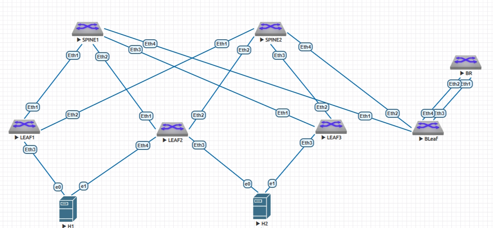
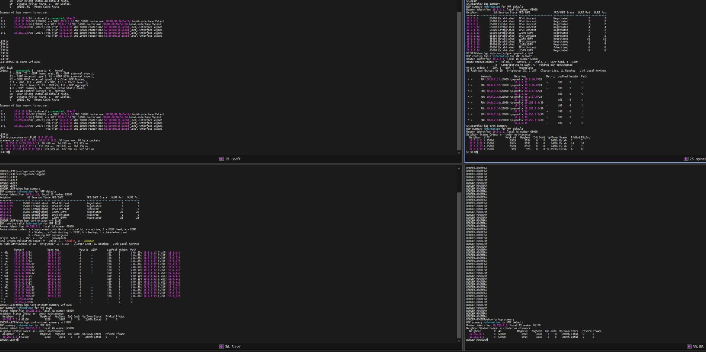
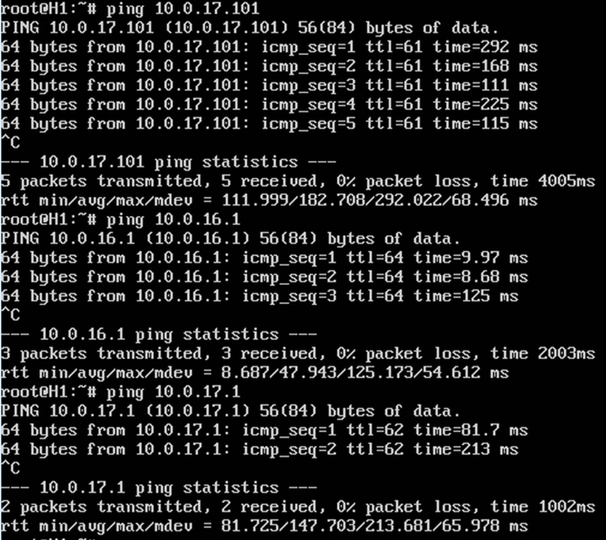
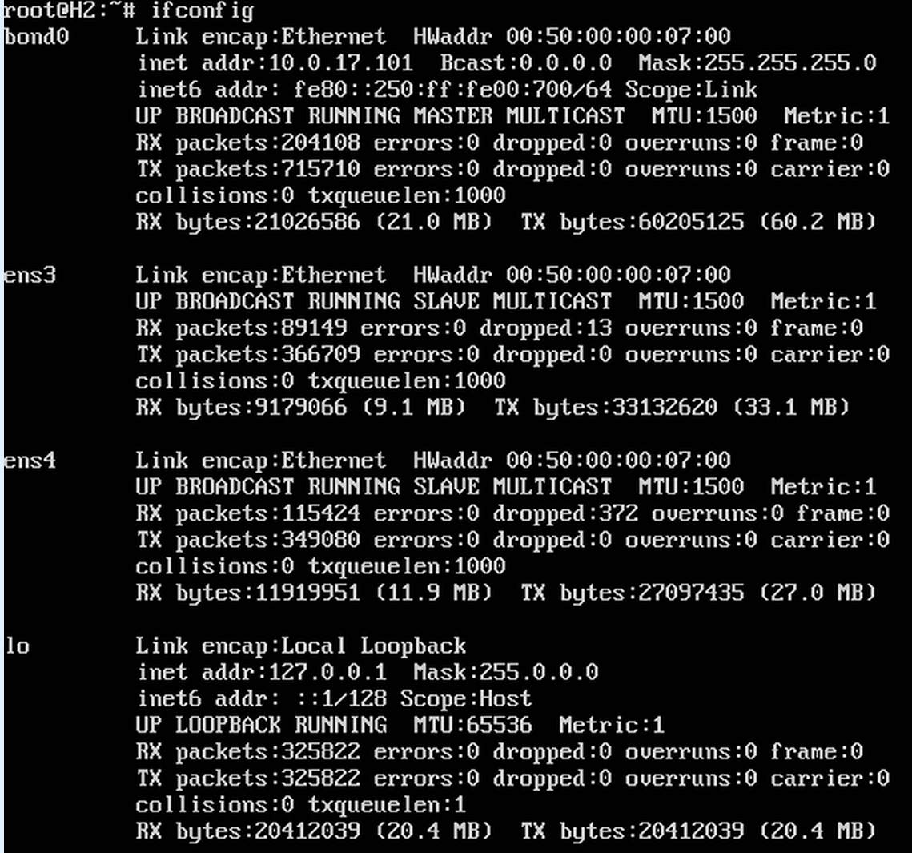

# VXLAN. Routing (EVPN Route Type-5)

## Цель

Реализовать передачу суммарных префиксов через EVPN Route Type-5 и организовать маршрутизацию между клиентами, находящимися в разных VRF, через внешнее устройство (граничный роутер).

В ходе работы было выполнено:
1. Размещены два клиента в разных VRF (BLUE и RED) в рамках одной фабрики Spine-Leaf.
2. Настроен BORDER-LEAF, который имеет оба VRF и выполняет роль шлюза между фабрикой и внешним роутером.
3. Настроен внешний BORDER-ROUTER (отдельный экземпляр vEOS, AS 65100), который выполняет маршрутизацию между VRF.
4. Настроен механизм переанонса EVPN Type-5 маршрутов (`route-target export evpn imported-route`) для передачи маршрутов между VRF через BORDER-LEAF.
5. Обеспечена сквозная связность между H1 (VRF BLUE) и H2 (VRF RED) через внешний BORDER-ROUTER.
В этой самостоятельной работе мы ожидаем, что вы самостоятельно:

1. Разместите двух "клиентов" в разных VRF в рамках одной фабрики.
2. Настроите маршрутизацию между клиентами через внешнее устройство (граничный роутер\фаерволл\etc)
3. Зафиксируете в документации - план работы, адресное пространство, схему сети, настройки сетевого оборудования
---

## Адресное пространство

Сеть DC `10.0.0.0/16`

| Назначение | CIDR | Использование |
|---|---|---|
| Loopback устройств | `10.0.1.0/24` | Router-ID, BGP |
| Underlay P2P | `10.0.0.0/24` | Spine ↔ Leaf |
| VTEP/Overlay Loopback | `10.0.2.0/24` | VXLAN VTEP |
| Service | `10.0.16.0/20` | Клиентские/серверные сети |
| Транзитные сети (BORDER) | `10.255.0.0/16` | Связь BORDER-LEAF ↔ BORDER-ROUTER |

---

## Таблицы IP-адресов

### Loopback0 (Router-ID)

| Device | Interface | IP | Назначение |
|---|---|---|---|
| SPINE1 | Lo0 | `10.0.1.1/32` | Router-ID, BGP |
| SPINE2 | Lo0 | `10.0.1.2/32` | Router-ID, BGP |
| LEAF1 | Lo0 | `10.0.1.11/32` | Router-ID, BGP |
| LEAF2 | Lo0 | `10.0.1.12/32` | Router-ID, BGP |
| LEAF3 | Lo0 | `10.0.1.13/32` | Router-ID, BGP |
| BORDER-LEAF | Lo0 | `10.0.1.14/32` | Router-ID, BGP |

### Loopback1 (VTEP)

| Device | Interface | IP | Назначение |
|---|---|---|---|
| LEAF1 | Lo1 | `10.0.2.11/32` | VXLAN VTEP |
| LEAF2 | Lo1 | `10.0.2.12/32` | VXLAN VTEP |
| LEAF3 | Lo1 | `10.0.2.13/32` | VXLAN VTEP |
| BORDER-LEAF | Lo1 | `10.0.2.14/32` | VXLAN VTEP |

### Underlay P2P (Spine ↔ Leaf, Spine ↔ BORDER-LEAF)

| Device | Interface | IP | Подключение |
|---|---|---|---|
| SPINE1 | Eth1 | `10.0.0.0/31` | LEAF1 |
| SPINE1 | Eth2 | `10.0.0.4/31` | LEAF2 |
| SPINE1 | Eth3 | `10.0.0.8/31` | LEAF3 |
| SPINE1 | Eth4 | `10.0.0.12/31` | BORDER-LEAF |
| SPINE2 | Eth1 | `10.0.0.2/31` | LEAF1 |
| SPINE2 | Eth2 | `10.0.0.6/31` | LEAF2 |
| SPINE2 | Eth3 | `10.0.0.10/31` | LEAF3 |
| SPINE2 | Eth4 | `10.0.0.14/31` | BORDER-LEAF |
| LEAF1 | Eth1 | `10.0.0.1/31` | SPINE1 |
| LEAF1 | Eth2 | `10.0.0.3/31` | SPINE2 |
| LEAF2 | Eth1 | `10.0.0.5/31` | SPINE1 |
| LEAF2 | Eth2 | `10.0.0.7/31` | SPINE2 |
| LEAF3 | Eth1 | `10.0.0.9/31` | SPINE1 |
| LEAF3 | Eth2 | `10.0.0.11/31` | SPINE2 |
| BORDER-LEAF | Eth1 | `10.0.0.13/31` | SPINE1 |
| BORDER-LEAF | Eth2 | `10.0.0.15/31` | SPINE2 |

### Транзитные сети (BORDER-LEAF ↔ BORDER-ROUTER)

| Device | Interface | VRF | IP | Назначение |
|---|---|---|---|---|
| BORDER-LEAF | Eth3 | BLUE | `10.255.0.1/30` | Транзит к BORDER-ROUTER (BLUE) |
| BORDER-LEAF | Eth4 | RED | `10.255.1.1/30` | Транзит к BORDER-ROUTER (RED) |
| BORDER-ROUTER | Eth1 | Default | `10.255.0.2/30` | Транзит к BORDER-LEAF (BLUE) |
| BORDER-ROUTER | Eth2 | Default | `10.255.1.2/30` | Транзит к BORDER-LEAF (RED) |

### Service (клиенты)

| Хост | Leaf | VRF | VLAN | Interface | IP | Шлюз |
|---|---|---|---|---|---|---|
| H1 | LEAF1 | BLUE | 10 | Eth3 | `10.0.16.101/24` | `10.0.16.1` |
| H2 | LEAF3 | RED | 20 | Eth3 | `10.0.17.101/24` | `10.0.17.1` |

---

## EVPN / VXLAN — параметры

### L2VNI (по одному на клиента)

| Параметр | BLUE (H1) | RED (H2) |
|---|---|---|
| VLAN | 10 | 20 |
| L2VNI | 10010 | 10020 |
| L2 RD | `10.0.2.11:10010` | `10.0.2.13:10020` |
| L2 RT | `65000:10010` | `65000:10020` |
| SVI | `Vlan10` | `Vlan20` |
| Подсеть | `10.0.16.0/24` | `10.0.17.0/24` |
| Anycast SVI | `10.0.16.1/24` | `10.0.17.1/24` |

### L3VNI (по одному на VRF)

| Параметр | BLUE | RED |
|---|---|---|
| VRF | BLUE | RED |
| L3VNI | 10000 | 20000 |
| L3 RD | `10.0.2.11:10000` | `10.0.2.13:20000` |
| L3 RT | `65000:10000` | `65000:20000` |
| VTEP | LEAF1 (10.0.2.11) | LEAF3 (10.0.2.13) |

### AS / общие параметры

| Параметр | Значение |
|---|---|
| AS (фабрика) | `65000` |
| AS (BORDER-ROUTER) | `65100` |
| Underlay | iBGP, Spine — RR |
| Overlay | iBGP EVPN по Loopback0, Spine — RR |
| VTEP source | Loopback1 |

---

## Схема сети



---

## План работы

### Часть 1. Underlay и базовая настройка
1. Настройка IP-адресации на физических интерфейсах и Loopback0.
2. Настройка iBGP в AS 65000 (Spine — Route Reflector).
3. Подключение BORDER-LEAF к Spine и настройка Underlay BGP.

### Часть 2. Overlay (EVPN/VXLAN) с L3VNI
4. Настройка Loopback1 (`10.0.2.0/24`) как VTEP на Leaf-ах.
5. Создание VRF BLUE и RED.
6. Настройка iBGP-сессий по Loopback0 для передачи EVPN-маршрутов.
7. Настройка L2VNI: VLAN 10 → VNI 10010 (BLUE), VLAN 20 → VNI 10020 (RED).
8. Настройка L3VNI: BLUE → 10000, RED → 20000.
9. Настройка SVI в соответствующих VRF с anycast-адресами (`ip address virtual`).

### Часть 3. Маршрутизация через внешнее устройство (BORDER-ROUTER)
10. Подключение BORDER-ROUTER к BORDER-LEAF двумя линками (по одному на каждый VRF).
11. Настройка транзитных сетей (`10.255.0.0/30` для BLUE, `10.255.1.0/30` для RED).
12. Настройка eBGP между BORDER-LEAF и BORDER-ROUTER (AS 65000 ↔ AS 65100).
13. Настройка переанонса EVPN Type-5 маршрутов между VRF на BORDER-LEAF через `route-target export evpn imported-route`.

---

## Конфигурация устройств

### SPINE1
```

hostname SPINE1
!
service routing protocols model multi-agent
!
interface Ethernet1
   description LEAF1
   no switchport
   ip address 10.0.0.0/31
!
interface Ethernet2
   description LEAF2
   no switchport
   ip address 10.0.0.4/31
!
interface Ethernet3
   description LEAF3
   no switchport
   ip address 10.0.0.8/31
!
interface Ethernet4
   description BORDER-LEAF
   no switchport
   ip address 10.0.0.12/31
!
interface Loopback0
   description Router-ID
   ip address 10.0.1.1/32
!
ip routing
!
route-map RM_connect permit 10
   match interface Loopback0
!
router bgp 65000
   router-id 10.0.1.1
   maximum-paths 10
   neighbor 10.0.0.1 remote-as 65000
   neighbor 10.0.0.1 next-hop-self
   neighbor 10.0.0.1 route-reflector-client
   neighbor 10.0.0.5 remote-as 65000
   neighbor 10.0.0.5 next-hop-self
   neighbor 10.0.0.5 route-reflector-client
   neighbor 10.0.0.9 remote-as 65000
   neighbor 10.0.0.9 next-hop-self
   neighbor 10.0.0.9 route-reflector-client
   neighbor 10.0.0.13 remote-as 65000
   neighbor 10.0.0.13 next-hop-self
   neighbor 10.0.0.13 route-reflector-client
   neighbor 10.0.1.11 remote-as 65000
   neighbor 10.0.1.11 update-source Loopback0
   neighbor 10.0.1.11 route-reflector-client
   neighbor 10.0.1.11 send-community extended
   neighbor 10.0.1.12 remote-as 65000
   neighbor 10.0.1.12 update-source Loopback0
   neighbor 10.0.1.12 route-reflector-client
   neighbor 10.0.1.12 send-community extended
   neighbor 10.0.1.13 remote-as 65000
   neighbor 10.0.1.13 update-source Loopback0
   neighbor 10.0.1.13 route-reflector-client
   neighbor 10.0.1.13 send-community extended
   neighbor 10.0.1.14 remote-as 65000
   neighbor 10.0.1.14 update-source Loopback0
   neighbor 10.0.1.14 route-reflector-client
   neighbor 10.0.1.14 send-community extended
   redistribute connected route-map RM_connect
   !
   address-family evpn
      neighbor 10.0.1.11 activate
      neighbor 10.0.1.12 activate
      neighbor 10.0.1.13 activate
      neighbor 10.0.1.14 activate
   !
   address-family ipv4
      neighbor 10.0.0.1 activate
      neighbor 10.0.0.5 activate
      neighbor 10.0.0.9 activate
      neighbor 10.0.0.13 activate
   

```

### SPINE2
```
hostname SPINE2
!
service routing protocols model multi-agent
!
interface Ethernet1
   description LEAF1
   no switchport
   ip address 10.0.0.2/31
!
interface Ethernet2
   description LEAF2
   no switchport
   ip address 10.0.0.6/31
!
interface Ethernet3
   description LEAF3
   no switchport
   ip address 10.0.0.10/31
!
interface Ethernet4
   description BORDER-LEAF
   no switchport
   ip address 10.0.0.14/31
!
interface Loopback0
   description Router-ID
   ip address 10.0.1.2/32
!
ip routing
!
route-map RM_connect permit 10
   match interface Loopback0
!
router bgp 65000
   router-id 10.0.1.2
   maximum-paths 10
   neighbor 10.0.0.3 remote-as 65000
   neighbor 10.0.0.3 next-hop-self
   neighbor 10.0.0.3 route-reflector-client
   neighbor 10.0.0.7 remote-as 65000
   neighbor 10.0.0.7 next-hop-self
   neighbor 10.0.0.7 route-reflector-client
   neighbor 10.0.0.11 remote-as 65000
   neighbor 10.0.0.11 next-hop-self
   neighbor 10.0.0.11 route-reflector-client
   neighbor 10.0.0.15 remote-as 65000
   neighbor 10.0.0.15 next-hop-self
   neighbor 10.0.0.15 route-reflector-client
   neighbor 10.0.1.11 remote-as 65000
   neighbor 10.0.1.11 update-source Loopback0
   neighbor 10.0.1.11 route-reflector-client
   neighbor 10.0.1.11 send-community extended
   neighbor 10.0.1.12 remote-as 65000
   neighbor 10.0.1.12 update-source Loopback0
   neighbor 10.0.1.12 route-reflector-client
   neighbor 10.0.1.12 send-community extended
   neighbor 10.0.1.13 remote-as 65000
   neighbor 10.0.1.13 update-source Loopback0
   neighbor 10.0.1.13 route-reflector-client
   neighbor 10.0.1.13 send-community extended
   neighbor 10.0.1.14 remote-as 65000
   neighbor 10.0.1.14 update-source Loopback0
   neighbor 10.0.1.14 route-reflector-client
   neighbor 10.0.1.14 send-community extended
   redistribute connected route-map RM_connect
   !
   address-family evpn
      neighbor 10.0.1.11 activate
      neighbor 10.0.1.12 activate
      neighbor 10.0.1.13 activate
      neighbor 10.0.1.14 activate
   !
   address-family ipv4
      neighbor 10.0.0.3 activate
      neighbor 10.0.0.7 activate
      neighbor 10.0.0.11 activate
      neighbor 10.0.0.15 activate
   


```

### LEAF1
```
hostname LEAF1
!
service routing protocols model multi-agent
!
vlan 10
   name BLUE-ZONE
!
vrf instance BLUE
!
ip routing
ip routing vrf BLUE
!
interface Ethernet1
   description SPINE1
   no switchport
   ip address 10.0.0.1/31
!
interface Ethernet2
   description SPINE2
   no switchport
   ip address 10.0.0.3/31
!
interface Ethernet3
   description CLIENT-H1
   switchport access vlan 10
!
interface Loopback0
   description Router-ID
   ip address 10.0.1.11/32
!
interface Loopback1
   description VTEP
   ip address 10.0.2.11/32
!
interface Vlan10
   vrf BLUE
   ip address virtual 10.0.16.1/24
!
interface Vxlan1
   vxlan source-interface Loopback1
   vxlan udp-port 4789
   vxlan vlan 10 vni 10010
   vxlan vrf BLUE vni 10000
   vxlan vlan 10 flood vtep 10.0.2.12 10.0.2.13 10.0.2.14
!
route-map RM_connect permit 10
   match interface Loopback0
!
route-map RM_connect permit 20
   match interface Loopback1
!
router bgp 65000
   router-id 10.0.1.11
   maximum-paths 10
   neighbor 10.0.0.0 remote-as 65000
   neighbor 10.0.0.2 remote-as 65000
   neighbor 10.0.1.1 remote-as 65000
   neighbor 10.0.1.1 update-source Loopback0
   neighbor 10.0.1.1 send-community extended
   neighbor 10.0.1.2 remote-as 65000
   neighbor 10.0.1.2 update-source Loopback0
   neighbor 10.0.1.2 send-community extended
   redistribute connected route-map RM_connect
   !
   vlan 10
      rd 10.0.2.11:10010
      route-target both 65000:10010
      redistribute learned
   !
   vrf BLUE
      rd 10.0.2.11:10000
      route-target import evpn 65000:9999
      route-target import evpn 65000:10000
      route-target export evpn 65000:10000
      redistribute connected
   !
   address-family evpn
      neighbor 10.0.1.1 activate
      neighbor 10.0.1.2 activate
   !
   address-family ipv4
      neighbor 10.0.0.0 activate
      neighbor 10.0.0.2 activate
   


```
### LEAF3
```
hostname LEAF3
!
service routing protocols model multi-agent
!
vlan 20
   name RED-ZONE
!
vrf instance RED
!
ip routing
ip routing vrf RED
!
interface Ethernet1
   description SPINE1
   no switchport
   ip address 10.0.0.9/31
!
interface Ethernet2
   description SPINE2
   no switchport
   ip address 10.0.0.11/31
!
interface Ethernet3
   description CLIENT-H2
   switchport access vlan 20
!
interface Loopback0
   description Router-ID
   ip address 10.0.1.13/32
!
interface Loopback1
   description VTEP
   ip address 10.0.2.13/32
!
interface Vlan20
   vrf RED
   ip address virtual 10.0.17.1/24
!
interface Vxlan1
   vxlan source-interface Loopback1
   vxlan udp-port 4789
   vxlan vlan 20 vni 10020
   vxlan vrf RED vni 20000
   vxlan vlan 20 flood vtep 10.0.2.11 10.0.2.12 10.0.2.14
!
route-map RM_connect permit 10
   match interface Loopback0
!
route-map RM_connect permit 20
   match interface Loopback1
!
router bgp 65000
   router-id 10.0.1.13
   maximum-paths 10
   neighbor 10.0.0.8 remote-as 65000
   neighbor 10.0.0.10 remote-as 65000
   neighbor 10.0.1.1 remote-as 65000
   neighbor 10.0.1.1 update-source Loopback0
   neighbor 10.0.1.1 send-community extended
   neighbor 10.0.1.2 remote-as 65000
   neighbor 10.0.1.2 update-source Loopback0
   neighbor 10.0.1.2 send-community extended
   redistribute connected route-map RM_connect
   !
   vlan 20
      rd 10.0.2.13:10020
      route-target both 65000:10020
      redistribute learned
   !
   vrf RED
      rd 10.0.2.13:20000
      route-target import evpn 65000:8888
      route-target import evpn 65000:20000
      route-target export evpn 65000:20000
      redistribute connected
   !
   address-family evpn
      neighbor 10.0.1.1 activate
      neighbor 10.0.1.2 activate
   !
   address-family ipv4
      neighbor 10.0.0.8 activate
      neighbor 10.0.0.10 activate

```
### BORDER-LEAF
```
hostname BORDER-LEAF
!
service routing protocols model multi-agent
!
vlan 10
   name BLUE-ZONE
vlan 20
   name RED-ZONE
!
vrf instance BLUE
vrf instance RED
!
ip routing
ip routing vrf BLUE
ip routing vrf RED
!
! --- Underlay в сторону Spine ---
interface Ethernet1
   description TO-SPINE1
   no switchport
   ip address 10.0.0.13/31
!
interface Ethernet2
   description TO-SPINE2
   no switchport
   ip address 10.0.0.15/31
!
! --- Транзитные интерфейсы к BORDER-ROUTER ---
interface Ethernet3
   description TRANSIT-BLUE
   no switchport
   vrf BLUE
   ip address 10.255.0.1/30
!
interface Ethernet4
   description TRANSIT-RED
   no switchport
   vrf RED
   ip address 10.255.1.1/30
!
interface Loopback0
   description Router-ID
   ip address 10.0.1.14/32
!
interface Loopback1
   description VTEP
   ip address 10.0.2.14/32
!
interface Vxlan1
   vxlan source-interface Loopback1
   vxlan udp-port 4789
   vxlan vlan 10 vni 10010
   vxlan vlan 20 vni 10020
   vxlan vrf BLUE vni 10000
   vxlan vrf RED vni 20000
!
route-map RM_connect permit 10
   match interface Loopback0
!
route-map RM_connect permit 20
   match interface Loopback1
!
router bgp 65000
   router-id 10.0.1.14
   maximum-paths 10
   neighbor 10.0.1.1 remote-as 65000
   neighbor 10.0.1.1 update-source Loopback0
   neighbor 10.0.1.1 send-community extended
   neighbor 10.0.1.2 remote-as 65000
   neighbor 10.0.1.2 update-source Loopback0
   neighbor 10.0.1.2 send-community extended
   redistribute connected route-map RM_connect
   !
   vlan 10
      rd 10.0.2.14:10010
      route-target both 65000:10010
      redistribute learned
   !
   vlan 20
      rd 10.0.2.14:10020
      route-target both 65000:10020
      redistribute learned
   !
   address-family evpn
      neighbor 10.0.1.1 activate
      neighbor 10.0.1.2 activate
   !
   vrf BLUE
      rd 10.0.2.14:10000
      route-target import evpn 65000:10000
      route-target import evpn 65000:20000
      route-target export evpn 65000:8888
      route-target export evpn 65000:10000
      route-target export evpn imported-route
      neighbor 10.255.0.2 remote-as 65100

   !
   vrf RED
      rd 10.0.2.14:20000
      route-target import evpn 65000:10000
      route-target import evpn 65000:20000
      route-target export evpn 65000:9999
      route-target export evpn 65000:20000
      route-target export evpn imported-route
      neighbor 10.255.1.2 remote-as 65100
   !
   address-family ipv4
      neighbor 10.255.0.2 activate
      neighbor 10.255.1.2 activate
   

```
###BORDER-ROUTER
```
hostname BORDER-ROUTER
!
ip routing
!
interface Ethernet1
   description TO-BORDER-LEAF-BLUE
   no switchport
   ip address 10.255.0.2/30
!
interface Ethernet2
   description TO-BORDER-LEAF-RED
   no switchport
   ip address 10.255.1.2/30
!
router bgp 65100
   router-id 10.255.0.2
   neighbor 10.255.0.1 remote-as 65000
   neighbor 10.255.1.1 remote-as 65000
   !
   address-family ipv4
      neighbor 10.255.0.1 activate
      neighbor 10.255.1.1 activate
   
```

### Для примера приведены выводы команд с LEAF1, BORDER-LEAF, SPINE1, BORDER-ROUTER




### Связность клиентов





